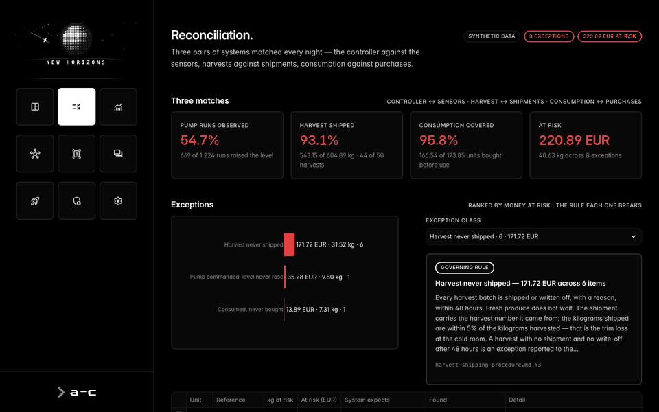
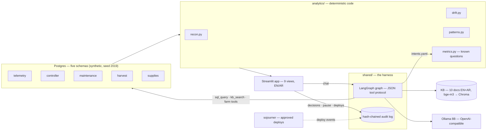

# new-horizons

<p align="center"></p>

**New Horizons** — an offline analytics and reconciliation agent for one aquaponics farm:
Streamlit + LangGraph on local 8B models, bilingual (English / Arabic), every figure
traceable to a query or a cited procedure. It is also the home of the shared agent harness
that its sibling, [sojourner](https://github.com/omarsoman/sojourner), uses to
develop, gate and deploy it.



## What it does

Four grow units, five source systems — sensor telemetry, the pump/air/dosing controller,
maintenance, harvest and shipping, supplies — 90 days of synthetic, seeded data with six
incidents planted in it. The agent's job is the one an operations analyst does by hand:
find where the systems stop agreeing, put a number on it, and say which procedure governs it.

| Page | What it shows |
|---|---|
| **Overview** | the period's findings ranked by money at risk, units, KPIs, trends |
| **Reconcile** | three matches — pump commanded vs water level, harvested vs shipped, consumed vs purchased — exceptions ranked by EUR, the governing rule, an approval bar (Farm Manager → approve / escalate / reject) |
| **Drift** | month × unit against the SOP bands; a probe that drifted vs chemistry that moved, with the calibration that proves it; sensor gaps never read as drift |
| **Patterns** | who touches which unit — a technician whose harvests never ship |
| **Documents** | a scanned invoice or water-lab report → OCR → fields verified against the text → reconciled → a held or payable alert citing the rule |
| **Chat** | known questions resolved in code, everything else by the agent, with its tool trace |
| **Changes** | what sojourner shipped to this app: each deploy, its approver and evaluation, from the same audit chain |

Ask *"How many kilograms did AQ-03 lose in the week after the pump failure, and what does
the maintenance SOP say the response time should have been?"* — the answer is **9.80 kg**
(6.31 kg harvested against 16.11 kg usual, 35.28 EUR), citing `pump-maintenance-sop.md §3`:
on site within 2 hours, while alert AL-2026-0001 waited **113.2 hours**. Same trace on
qwen3:8b, llama3.1:8b and deepseek-r1:8b.

## Architecture



Correctness lives in code, not the prompt: known questions resolve through
`intents.yaml` → `metrics.py`; free answers pass a figure gate (every number must come from a
tool result or retrieved text) and a language check; discrepancies are found by
`recon.py`, never by the model; governance — approvals, the agent's pause switch, deploys —
is an event in a hash-chained log, never UI state. `shared/` never imports the app, and
views never import each other (import-linter enforces both).

## Run

Needs macOS or Linux, Docker, [uv](https://docs.astral.sh/uv/), [Ollama](https://ollama.com),
Tesseract (`brew install tesseract`) and 16 GB of RAM.

```sh
source scripts/ollama-env.sh && ollama serve     # separate terminal: num_ctx 8192, q8_0 KV cache
make models                                      # qwen3:8b llama3.1:8b deepseek-r1:8b qwen3-vl:4b bge-m3
uv sync
make db-up mock kb                               # Postgres, the five databases + analytics + scans, the KB (~5 s)
make demo1                                       # http://localhost:8501
```

`make test` (needs `db-up`; the farm tests need `mock kb`) · `make lint` (import contracts) ·
`make client-free` · the bilingual scorecard:
`uv run python scripts/question-bank.py --set docs/question-set.yaml [--model llama3.1:8b]`.
A walkthrough is in [docs/DEMO.md](docs/DEMO.md).

## Example

| question | answered by | result |
|---|---|---|
| How much money is sitting in unresolved reconciliation? | `metric:recon_exposure` | 220.89 EUR across 8 exceptions — 171.72 harvests never shipped, 35.28 pump commanded with no level rise, 13.89 feed never bought |
| لماذا أُوقفت الفاتورة INV-2026-0418؟ | `metric:held_invoice` | 2.95 EUR/kg against 2.40 on the purchase order (+22.9 %, outside the 5 % tolerance), from SUP-007, not the ordered SUP-001 — in Arabic |
| Is the pH drift on AQ-04 a sensor problem or a chemistry problem? | `metric:ph_drift_cause` | the probe: lab 6.89 vs probe 7.28, fixed by the 21 August calibration |

The 26-question bilingual set (13 EN + 13 AR, follow-ups, colloquial and off-script
questions — [docs/question-set.md](docs/question-set.md)) scores 26/26 on qwen3:8b and 25/26
on llama3.1:8b; Sojourner's deploy gate re-runs it on every change.

## Stack

Python 3.12 · uv · Streamlit · LangGraph (JSON tool protocol, no `bind_tools`) · Ollama
(qwen3:8b, llama3.1:8b, deepseek-r1:8b; qwen3-vl:4b for scans; bge-m3 embeddings) ·
Postgres 16 · Chroma · Tesseract + PyMuPDF · Plotly · import-linter · pytest. Everything
runs on one laptop with no network; an OpenAI-compatible lane switch (`make llm-target`)
moves chat to a rented GPU box without touching the code. The data, the farm and every
person in it are synthetic.

## Author

Omar Soman — founder of [Agentization Core](https://agentization-core.com) ·
[LinkedIn](https://www.linkedin.com/in/omarsoman). MIT-licensed — see [LICENSE](LICENSE);
security model in [SECURITY.md](SECURITY.md).
