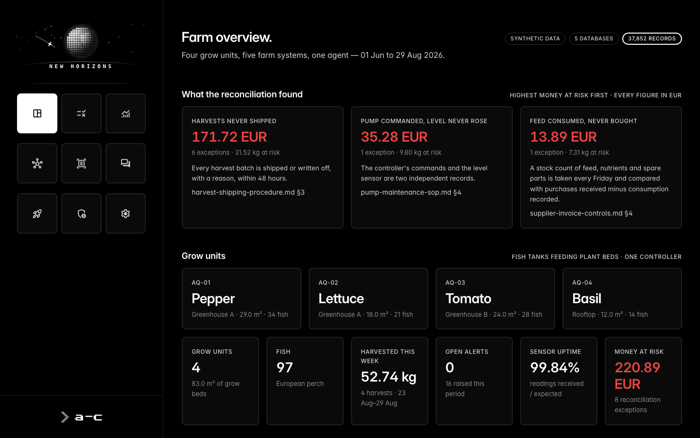
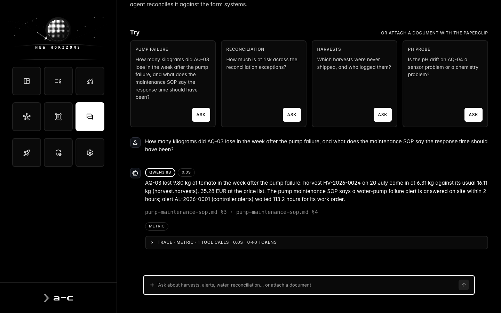
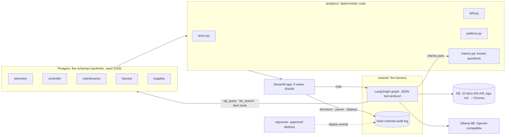

# new-horizons

**New Horizons** is an offline analytics and reconciliation agent for one aquaponics farm:
Streamlit + LangGraph on local 8B models, bilingual (English / Arabic), every figure
traceable to a query or a cited procedure. It is also the home of the shared agent harness
that its sibling, [sojourner](https://github.com/Omisoman/sojourner), uses to
develop, gate and deploy it.



## What it does

Four grow units, five source systems (sensor telemetry, the pump, air and dosing controller,
maintenance, harvest and shipping, supplies), 90 days of synthetic, seeded data with six
incidents planted in it. The agent's job is the one an operations analyst does by hand:
find where the systems stop agreeing, put a number on it, and say which procedure governs it.

| Page | What it shows |
|---|---|
| **Overview** | the period's findings ranked by money at risk, units, KPIs, trends |
| **Reconcile** | three matches (pump commanded vs water level, harvested vs shipped, consumed vs purchased), exceptions ranked by EUR, the governing rule, an approval bar (Farm Manager: approve, escalate or reject) |
| **Drift** | month × unit against the SOP bands; a probe that drifted vs chemistry that moved, with the calibration that proves it; sensor gaps never read as drift |
| **Patterns** | who touches which unit: a technician whose harvests never ship |
| **Documents** | a scanned invoice or water-lab report → OCR → fields verified against the text → reconciled → a held or payable alert citing the rule |
| **Chat** | known questions resolved in code, everything else by the agent, with its tool trace |
| **Changes** | what sojourner shipped to this app: each deploy, its approver and evaluation, from the same audit chain |


Ask *"How many kilograms did AQ-03 lose in the week after the pump failure, and what does
the maintenance SOP say the response time should have been?"* The answer is **9.80 kg**
(6.31 kg harvested against 16.11 kg usual, 35.28 EUR), citing `pump-maintenance-sop.md §3`:
on site within 2 hours, while alert AL-2026-0001 waited **113.2 hours**. Same trace on
qwen3:8b, llama3.1:8b and deepseek-r1:8b.



## Architecture



Correctness lives in code, not the prompt: known questions resolve through
`intents.yaml` → `metrics.py`; free answers pass a figure gate (every number must come from a
tool result or retrieved text) and a language check; discrepancies are found by
`recon.py`, never by the model; governance (approvals, the agent's pause switch, deploys)
is an event in a hash-chained log, never UI state. `shared/` never imports the app, and
views never import each other (import-linter enforces both). The security model is in
[SECURITY.md](SECURITY.md).

## Run

Needs macOS or Linux, Docker, [uv](https://docs.astral.sh/uv/), [Ollama](https://ollama.com),
Tesseract (`brew install tesseract`) and 16 GB of RAM.

```sh
source scripts/ollama-env.sh && ollama serve     # separate terminal: num_ctx 8192, q8_0 KV cache
make models                                      # qwen3:8b llama3.1:8b deepseek-r1:8b qwen3-vl:4b bge-m3
uv sync
make db-up mock kb                               # Postgres, the five databases + analytics + scans, the KB (~5 s)
make demo1                                       # http://localhost:8501
```

`make test` (needs `db-up`; the farm tests need `mock kb`) · `make lint` (import contracts) ·
`make client-free` · the bilingual scorecard:
`uv run python scripts/question-bank.py --set docs/question-set.yaml [--model llama3.1:8b]`.
A walkthrough is in [docs/DEMO.md](docs/DEMO.md).

## Models (not in this repo)

No model weights are in this repository. `make models` pulls these from Ollama; the first run needs roughly 20 GB of disk and a machine with 16 GB RAM (24 GB for all five at once).

| Model | Role | Download | Ollama |
|---|---|---|---|
| `qwen3:8b` | the analytics agent (default chat model) | 5.2 GB | [ollama.com/library/qwen3:8b](https://ollama.com/library/qwen3:8b) |
| `llama3.1:8b` | second opinion in the question bank | 4.9 GB | [ollama.com/library/llama3.1:8b](https://ollama.com/library/llama3.1:8b) |
| `deepseek-r1:8b` | reasoning comparisons | 5.2 GB | [ollama.com/library/deepseek-r1:8b](https://ollama.com/library/deepseek-r1:8b) |
| `qwen3-vl:4b` | document intake: structures the OCR text of a scan into fields, every value checked against the text (regex is the fallback) | 3.3 GB | [ollama.com/library/qwen3-vl:4b](https://ollama.com/library/qwen3-vl:4b) |
| `bge-m3` | embeddings for the knowledge base and the question matcher | 1.2 GB | [ollama.com/library/bge-m3](https://ollama.com/library/bge-m3) |

Sizes are what `ollama list` reports on the author's Mac. `scripts/ollama-env.sh` holds the
serve settings: 8192-token context, q8_0 KV cache, flash attention, at most two models loaded.

## Data

All data is synthetic. `make mock` (`src/new_horizons/app/mock/generate.py`, on the physics of
`data/_seed/gen_aquaponics.py`) generates 90 days of telemetry, controller, maintenance,
harvest, shipping and supplier records for one fictional aquaponics farm (seed 2019) with
planted incidents: a pump failure on grow unit AQ-03 from 12 to 18 July, a heatwave 26 to 30
July, six harvests that were never shipped, a feed nobody bought, sensor dropouts and a pH
probe drift on AQ-04. The knowledge base in `src/new_horizons/app/ingest/kb_synthetic/` is
written for that farm. No real company, person or client appears anywhere.

```sh
make db-up mock    # generate the farm; load the five databases, the analytics and the sample scans
make kb            # load the knowledge base into Chroma (bge-m3, ~5 s)
```

## Example

| question | answered by | result |
|---|---|---|
| How much money is sitting in unresolved reconciliation? | `metric:recon_exposure` | 220.89 EUR across 8 exceptions: 171.72 harvests never shipped, 35.28 pump commanded with no level rise, 13.89 feed never bought |
| لماذا أُوقفت الفاتورة INV-2026-0418؟ | `metric:held_invoice` | 2.95 EUR/kg against 2.40 on the purchase order (+22.9 %, outside the 5 % tolerance), from SUP-007, not the ordered SUP-001; answered in Arabic |
| Is the pH drift on AQ-04 a sensor problem or a chemistry problem? | `metric:ph_drift_cause` | the probe: lab 6.89 vs probe 7.28, fixed by the 21 August calibration |

The 26-question bilingual set (13 EN + 13 AR, follow-ups, colloquial and off-script
questions; [docs/question-set.md](docs/question-set.md)) scores 26/26 on qwen3:8b and 25/26
on llama3.1:8b; Sojourner's deploy gate re-runs it on every change.

## Stack

Python 3.12 · uv · Streamlit · LangGraph (JSON tool protocol, no `bind_tools`) · Ollama
(qwen3:8b, llama3.1:8b, deepseek-r1:8b; qwen3-vl:4b for scans; bge-m3 embeddings) ·
Postgres 16 · Chroma · Tesseract + PyMuPDF · Plotly · import-linter · pytest. Everything
runs on one laptop with no network; an OpenAI-compatible lane switch (`make llm-target`)
moves chat to a rented GPU box without touching the code. The data, the farm and every
person in it are synthetic.

## Author

Omar Soman, Software Engineer, Agentic AI Systems, author of Agentization Core. [github.com/Omisoman](https://github.com/Omisoman), [agentization-core.com](https://agentization-core.com), [linkedin.com/in/omarsoman](https://www.linkedin.com/in/omarsoman).

## License

MIT licensed, see [LICENSE](LICENSE).
